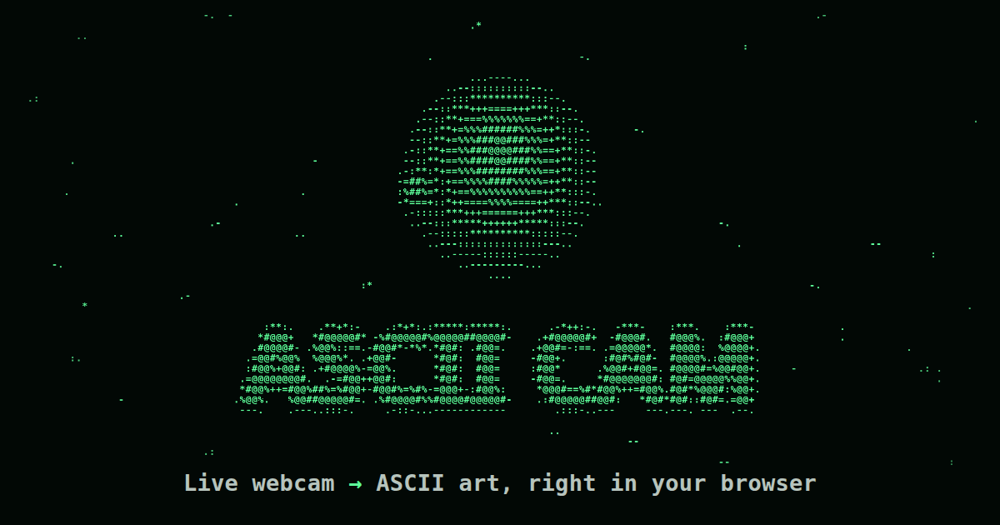

# ASCII Cam: live webcam ASCII art

<p align="center">
  <a href="https://aljazfrancic.github.io/live-webcam-ascii-art/"></a>
</p>

Turn your webcam into live ASCII art, right in the browser. Rendering runs on the GPU where available, there is no build step and no dependencies, and it is private by design: every frame is processed on your device and nothing is uploaded.

**[Open the app →](https://aljazfrancic.github.io/live-webcam-ascii-art/)**

## Features

- **Six character sets:** Classic, Detailed (70 glyphs), Blocks, Braille (2×4 dots per cell), Binary, or your own characters. Each glyph's ink coverage is measured in your browser's own font, so tones come out right on every system and custom characters are sorted automatically.
- **Eight palettes:** Phosphor, Amber, Ice, Mono, Paper (dark ink on light), True color, Thermal and Synthwave. The interface accent follows the palette.
- **Image controls:** detail (24 to 320 columns), brightness, contrast, auto levels, temporal stabilization, invert, mirror, and edge detection that traces outlines with `| / - \`.
- **Snapshots** as PNG, re-rendered at up to 4× resolution so they stay sharp even from a phone. On phones they open the share sheet, so you can save straight to your photos.
- **Copy as text:** paste the current frame anywhere as plain text, Braille included.
- **Video recording** of up to 60 seconds: MP4 where the browser supports it, WebM otherwise.
- **Camera switching:** front and back cameras on phones, or any connected camera on desktop.
- **Pause, full screen, keyboard shortcuts**, and settings that are remembered per browser.
- **Installable:** add it to your home screen, or install it as a desktop app from the address bar.
- **Responsive layouts** for phones (portrait and landscape), tablets and desktops, with labelled controls for keyboard and screen-reader users and a static preview under `prefers-reduced-motion`.

## Keyboard shortcuts

| Key | Action | Key | Action |
| --- | --- | --- | --- |
| <kbd>Space</kbd> | Start camera / pause | <kbd>S</kbd> | Save snapshot |
| <kbd>C</kbd> | Copy frame as text | <kbd>R</kbd> | Record video |
| <kbd>1</kbd>–<kbd>6</kbd> | Character set | <kbd>P</kbd> / <kbd>Shift</kbd>+<kbd>P</kbd> | Next / previous palette |
| <kbd>[</kbd> <kbd>]</kbd> | Less / more detail | <kbd>I</kbd> <kbd>E</kbd> <kbd>M</kbd> <kbd>L</kbd> | Invert, edges, mirror, auto levels |
| <kbd>V</kbd> | Switch camera | <kbd>X</kbd> | Turn camera off |
| <kbd>F</kbd> | Full screen | <kbd>O</kbd> | Settings |
| <kbd>?</kbd> | Help | <kbd>Esc</kbd> | Close panel or dialog |

## Privacy

Frames go from the camera into a canvas and the GPU, and nowhere else. The page ships a strict Content Security Policy with `connect-src 'none'`, so it can't send data anywhere even by accident. There are no analytics, trackers or cookies; your settings live in `localStorage` on your own device.

## Performance

ASCII Cam is built to stay smooth on old laptops and budget phones:

- The camera is asked for about 640 px of width in its native aspect ratio. That's enough for the densest grid and cheap to read back each frame.
- Each frame is shrunk to one pixel per character cell, and brightness, contrast, levels and glyph choice are folded into 256-entry lookup tables.
- **WebGL** draws the entire grid in a single draw call from a glyph atlas texture. Where hardware WebGL is missing, a **Canvas 2D fallback** composites glyphs in JavaScript and pushes one `putImageData` per frame instead of thousands of draw calls. Both renderers produce pixel-identical output.
- Frames are paced by `requestVideoFrameCallback`, so only new camera frames are processed, and there is a frame-rate cap of 12, 24, 30 or 60 fps. The device pixel ratio is capped at 2, nothing in the page layout changes per frame, and all work stops in background tabs.

Main-thread time per frame, measured in headless Chrome with a 640×480 test feed at the default detail:

| Renderer | Desktop | Desktop, CPU slowed 4× | Phone 390×844, CPU slowed 6× |
| --- | --- | --- | --- |
| WebGL | 1.5–3.1 ms | 5–12 ms | 8–14 ms |
| Canvas 2D fallback | 2.9–5.0 ms | 11–22 ms | 16–29 ms |

Every scenario kept up with the camera's 30 fps. For comparison, color mode in the previous version rebuilt about 11,000 `<span>` elements per frame and managed 9.7 fps on the same desktop, and 2.7 fps with the CPU slowed 4×.

## Browser support

Works in current Chrome, Edge, Firefox and Safari, on desktop and mobile. Camera access needs `https://` or `localhost`. Recording needs `MediaRecorder`; the button is hidden where it's missing. Full screen isn't available on iPhone, so that button is hidden there.

## Run it locally

No build step, no dependencies:

```bash
git clone https://github.com/aljazfrancic/live-webcam-ascii-art.git
cd live-webcam-ascii-art
python3 -m http.server 8000
```

Then open <http://localhost:8000>. Use a local server rather than opening `index.html` directly, because some browsers block the camera on `file://` pages.

For troubleshooting, `?renderer=webgl` or `?renderer=canvas` forces a renderer, and `?debug` exposes state on `window.asciiCam`.

## Project structure

```
index.html            markup, inline icon sprite, meta tags and CSP
style.css             all styling (system fonts, no frameworks)
app.js                camera, image analysis, WebGL / Canvas 2D renderers, UI
favicon.svg, .ico     favicons
manifest.webmanifest  home-screen metadata
assets/               touch and app icons, social preview image
```

## Deployment

The site is static, so GitHub Pages serves it as is: in the repository settings under **Pages**, deploy from the `main` branch, root folder `/`.

## License

[MIT](LICENSE)
